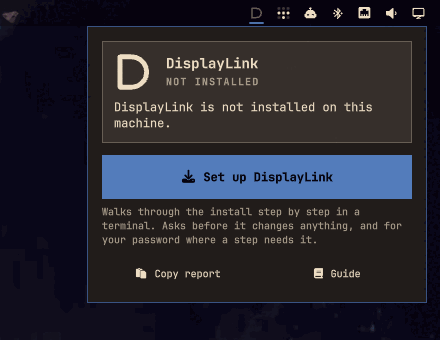
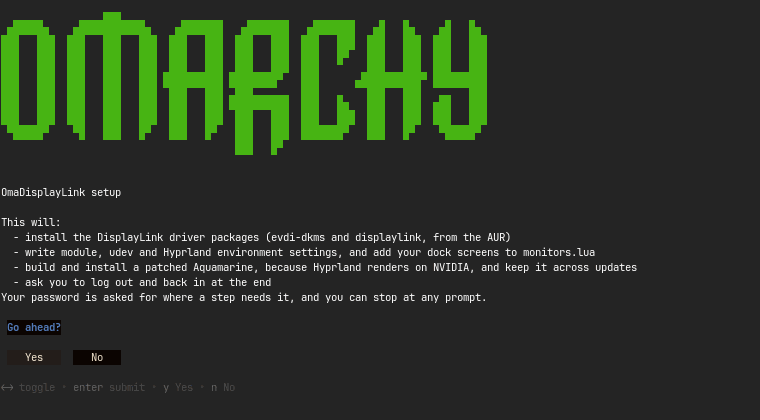
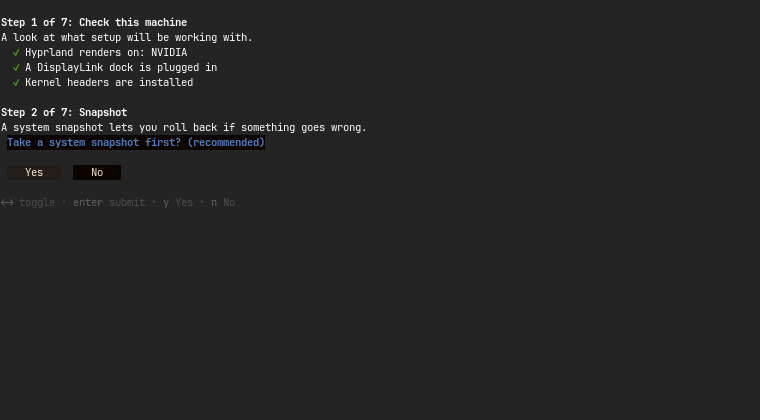
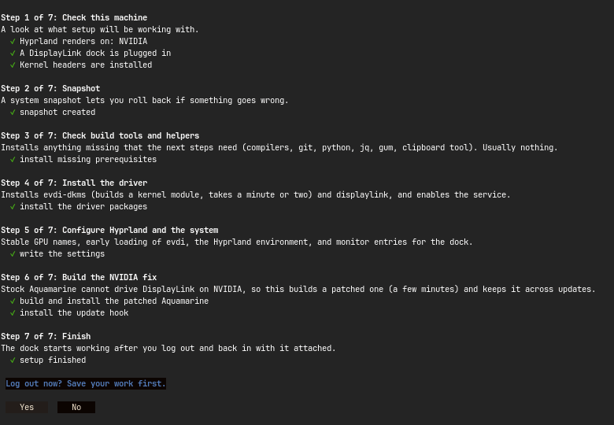
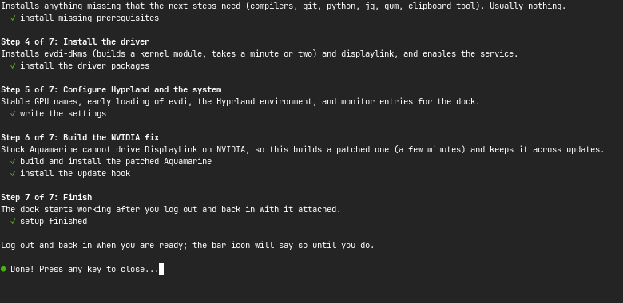
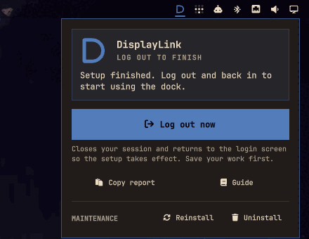
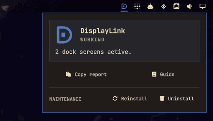
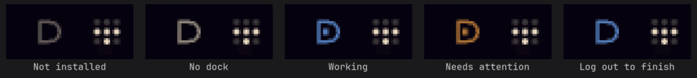

# OmaDisplayLink

**Use a DisplayLink USB dock or hub (Plugable, StarTech, Dell, Lenovo, and others) as extra monitors on [Omarchy](https://omarchy.org/): Arch Linux + Hyprland, including NVIDIA and Wayland.**

If your DisplayLink screens show **no signal**, stay at **0x0**, or Hyprland logs `drmPrimeFDToHandle failed` / `Buffer failed to import to KMS`, this project is for you.

> **Status: experimental.** The scripts are verified end to end on one machine (see [Tested hardware](#tested-hardware)). The plugin's guided setup has been walked through in its demo mode and the bar card used on that machine, but has not yet been run on a machine without the driver. AMD and Intel should need less and are expected to work, but nobody has run them yet. Reports from other setups are welcome.
>
> This is an independent community project. It is not affiliated with or endorsed by Omarchy, Hyprland, Synaptics/DisplayLink, or any dock vendor.

## Install

**BASH** · Install current upstream

```bash
omarchy plugin add https://github.com/bmaltais/OmaDisplayLink.git --enable
```

Then click the new **D** icon in the bar and choose **Set up DisplayLink**. [Step-by-step with screenshots](#install-walkthrough), or the [command-line route](#manual-install-command-line) if you would rather not use the plugin.

## What you get

DisplayLink docks are not ordinary USB-C or DisplayPort docks. They send video over USB and need the **evdi** kernel module plus the proprietary **DisplayLink** userspace driver, and Hyprland has to be told how to use the resulting virtual screens. OmaDisplayLink does all of that for you:

- **A bar icon and a card** that say whether the dock is working and offer the one thing to do next: set up, log out to finish, repair, reinstall or uninstall.
- **Guided setup** in a visible terminal: numbered steps, a plain-language line for each, and a question before anything changes.
- **On NVIDIA**, a patched Aquamarine (Hyprland's backend library) with the CPU-copy fallback from [hyprwm/aquamarine#279](https://github.com/hyprwm/aquamarine/pull/279), because stock Aquamarine cannot drive evdi outputs on NVIDIA. An update hook re-applies it after `omarchy update`.
- A **full undo**, a **diagnostic report** you can paste into an issue, and a **benchmark** of what the DisplayLink path costs.

Everything is a plain shell script you can read, and every change has a documented undo.

## Install walkthrough

You do not need to use a terminal for most of this. The plugin puts an icon in your bar; its card walks you through the rest. (Prefer the command line? See [Manual install](#manual-install-command-line).)

> The screenshots below come from the plugin's demo mode, which asks the real questions and simulates the steps, so nothing was installed to take them. A real run takes a few minutes longer and may ask for your password.

### 1. Add the plugin

```bash
omarchy plugin add https://github.com/bmaltais/OmaDisplayLink.git --enable
```

Omarchy warns that plugins run unsandboxed inside your shell and asks you to confirm; read the code first if you like, it is all in this repo. If it asks which part of the bar the icon should go in, the default (right) is fine. A dim "D" appears in the bar.

### 2. Click the icon, then **Set up DisplayLink**

The card says what state things are in and offers the one thing to do. Nothing is installed yet, so that is setup.



### 3. Answer the questions

A terminal opens in Omarchy's style. First it says what it is about to do and asks for a go-ahead. You can stop at any prompt, and nothing has changed until you answer yes.



Then it offers a **system snapshot**, which lets you roll the whole machine back if something goes wrong. It takes a few seconds and is worth saying yes to.



Where a step needs administrator rights, the terminal asks for your password.

### 4. Let it run

Each step has a title, a line saying what it does, and a check mark when it is done. If a step fails it stops, says which one, and tells you how to ask for help.



| Step | What it does | Time |
|---|---|---|
| 1. Check this machine | Looks at your GPU, dock and kernel headers. Changes nothing | seconds |
| 2. Snapshot | The optional system snapshot | seconds |
| 3. Check build tools and helpers | Installs anything missing that the next steps need (on stock Omarchy usually `cmake`, `hyprwayland-scanner`, `usbutils`) | seconds |
| 4. Install the driver | Builds `evdi-dkms` (a kernel module) and installs `displaylink` from the AUR, then enables the service | a minute or two |
| 5. Configure Hyprland and the system | Stable GPU names, early loading of evdi, the Hyprland environment block, monitor entries for the dock | seconds |
| 6. Build the NVIDIA fix | **NVIDIA only.** Builds a patched Aquamarine and installs the update hook that keeps it patched | a few minutes |
| 7. Finish | Marks setup as waiting for a login | seconds |

On AMD or Intel there is no step 6, so setup has six steps.

### 5. Log out and back in

The dock only starts working after a fresh login, because Hyprland reads its graphics settings once at startup. The last question offers to log you out for you; save your work first. Plug the dock into a **USB 3 / SuperSpeed** port, and have it attached when you log back in.



If you answer No, nothing is lost: the icon stays on **Log out to finish**, and the card keeps a **Log out now** button until you have logged in again.



### 6. Check that it works

Back in your session, the icon is **blue** and the card says how many dock screens are active. There is nothing left to do, so the card has no big button.



The icon tells you the state without opening anything:



If it turns **orange or red**, open the card: it says in a sentence what is wrong and offers the fix when there is one (for example **Repair the NVIDIA fix** after an update, or **Reinstall** after a kernel update). **Copy report** puts a sanitized report on your clipboard to paste into a [GitHub issue](https://github.com/bmaltais/OmaDisplayLink/issues). If a screen shows "no signal" while the card says it is active, check the monitor's input source and cable first.

### Later: reinstall and uninstall

The card's **Maintenance** row has **Reinstall** (rebuilds the evdi module and restarts the service, for after a kernel update) and **Uninstall** (removes the driver and everything setup added). Both open a terminal, list what they will do, and ask first. Uninstall leaves your `monitors.lua` alone.

## Manual install (command line)

Not using the plugin, or want to script it? The same scripts, step by step, with `--preview` on everything: [docs/manual-install.md](docs/manual-install.md).

## Tested hardware

| | |
|---|---|
| Dock | Plugable UD-3900PDZ (triple HDMI, two DisplayLink heads) |
| GPU | NVIDIA RTX 3090 (nvidia-open) |
| Software | Omarchy, Hyprland 0.56.2, Aquamarine 0.15.1, evdi 1.15.1, `displaylink` 6.4 |
| Link | USB 2 (480M) |
| Result | Two dock screens plus a native screen, replug and mode changes work |

Cost on that machine: about 1.4% of one core for Hyprland when idle, and 73–82% in a deliberately harsh worst case (a 900x600 terminal printing continuously while jumping across the screens). See [Measure the cost](docs/displaylink.md#measure-the-cost). Others in the Aquamarine PR thread report it working on an RTX 5070 and an RTX 2080 Ti with an Elgato Prompter.

Have a different dock or GPU? Run `./scripts/displaylink-detect.sh --sanitize` and open an issue with the result and whether it worked.

## Symptoms this fixes

Search-engine-friendly list of what people actually see:

- DisplayLink monitor **shows no signal / black screen** on Hyprland or Omarchy
- `hyprctl monitors` lists `DVI-I-1` / `DVI-I-2` but at **0x0** or disabled
- `drm: drmPrimeFDToHandle failed`, `Buffer failed to import to KMS`
- DisplayLink works on Windows but not on Omarchy / Arch Linux / Wayland
- evdi on **NVIDIA with Wayland** produces no output (works on X11 or on AMD/Intel)
- Screens vanish after `omarchy update` (a new Aquamarine dropped the patch): the update hook handles this
- `AQ_NO_MODIFIERS=1` "fixes" the dock but greys out your main monitors (not needed here; the patch is the real fix)

Also check your monitor's input source before debugging further: a healthy dock output can look like "no signal" if the monitor is set to another input.

## How it works

1. **evdi** creates virtual DRM cards that the DisplayLink service feeds with frames over USB.
2. **udev rules** give those cards and your real GPU stable names so `AQ_DRM_DEVICES` never points at the wrong device.
3. **Hyprland** (through Aquamarine) renders on the real GPU and hands finished frames to evdi. On AMD and Intel that import works. On NVIDIA the driver refuses to share its buffers with evdi, so the patched Aquamarine reads the frame back and copies it into a plain buffer instead. That costs CPU, which is why heavy motion is the expensive case.

## Update safety

- `displaylink-aquamarine-patch.sh --status` prints `patched` or `stock`.
- The hook runs after every `omarchy update`: it does nothing unless Hyprland renders on NVIDIA and the library lost the fix, then rebuilds, verifies the build really carries the fix, installs it, and notifies you. If the patch stops applying, you get a notification and the system package is left alone.
- After a kernel update, if the dock stops working, the card says the evdi module is missing and offers **Reinstall** (command line: `./scripts/displaylink-rebuild.sh`).
- Once upstream merges the fix and Arch ships it, remove the hook and use the stock package (steps in the guide).

## Uninstall

Use **Uninstall** in the card's Maintenance row, or from a terminal:

```bash
./scripts/displaylink-uninstall.sh --preview   # what it would do, nothing changed
./scripts/displaylink-uninstall.sh            # step by step, after a confirmation
```

It stops the service, removes the setup files, the Hyprland environment block and the update hook, puts the stock Aquamarine back if the patched one is installed, and removes the packages. Your `monitors.lua` is left alone. The manual steps are in [docs/displaylink.md](docs/displaylink.md#undo).

## Contributing

Reports, hardware results and pull requests are welcome. Keep everything public-safe: no hostnames, serials, MAC addresses, home paths or unsanitized `hyprctl` output. See [AGENTS.md](AGENTS.md). Working on the plugin itself, including the demo mode used for the screenshots: [docs/development.md](docs/development.md).

## Credits

The CPU-copy fallback is based on the work of the author of [hyprwm/aquamarine#279](https://github.com/hyprwm/aquamarine/pull/279), adapted here to Aquamarine 0.15.1. Thanks to the Hyprland, Aquamarine, evdi and Omarchy projects.

## Keywords

DisplayLink Omarchy, DisplayLink Hyprland, DisplayLink Arch Linux, DisplayLink Wayland, DisplayLink NVIDIA Linux, evdi Hyprland, evdi NVIDIA Wayland, USB graphics adapter Linux, Plugable UD-3900PDZ Linux, triple monitor USB dock Linux, Aquamarine evdi.

## License

[MIT](LICENSE). The bundled Aquamarine patch is a derivative of Aquamarine (BSD-3-Clause); the `displaylink` driver is proprietary and installed from the AUR under its own license.
